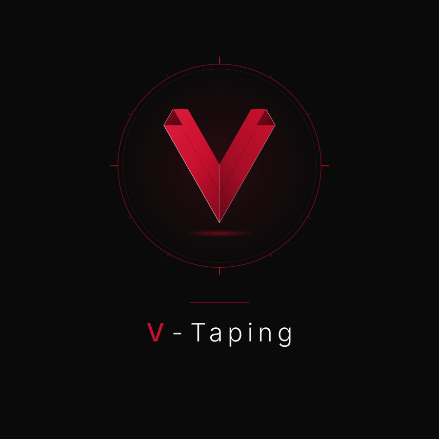

<p align="center">
  <a href="https://github.com/ginganomercy/v-taping-app">
    
  </a>
</p>

<p align="center">
  <strong>Athletic Kinesiology Taping &bull; Calisthenics V-Taper Protocol &bull; Hybrid Runner GPS Tracker</strong>
  <br />
  <em>Dirancang khusus untuk transformasi postur atletis Doritos Shape, perlindungan sendi panggul (Hip Shield), dan pelacakan kardio luring penuh.</em>
</p>

<p align="center">
  <a href="https://github.com/ginganomercy/v-taping-app/releases/tag/v1.0.1">
    
  </a>
  <a href="https://github.com/ginganomercy/v-taping-app/releases/download/v1.0.1/app-debug.apk">
    
  </a>
  
  
  
</p>

---

## 🎨 Identitas Visual & Anatomi Logo

Aplikasi menggunakan identitas grafis resmi berbasis vektor murni (**V-Taping**). Seluruh aset telah dikonversi secara presisi ke dalam format **SVG Standalone**, **PWA Web App**, dan **Android Vector Drawable XML**:

<p align="center">
  
  &nbsp;&nbsp;&nbsp;&nbsp;&nbsp;&nbsp;&nbsp;&nbsp;
  
</p>

### Filosofi Desain:
1. **Dua Pita Kinesiology Menyilang:**
   Representasi visual dari teknik *strapping / taping* kinesiology atletik yang menstabilkan sendi panggul (*gluteus medius*) dan otot punggung atas (*latissimus dorsi, rear deltoid*). Bentuk pertemuan tajam di ujung bawah membentuk siluet sudut $V$ (*Doritos V-Taper*).
2. **Retikel Kronometer Presisi:**
   Lingkaran ganda konsentris ($r=250$, $r=238$) dilengkapi 4 penanda kardinal dan 8 sub-titik sudut 30° yang merepresentasikan instrumen pengukuran biomekanik terkalibrasi tinggi.
3. **Bevel 3D & Jahitan Perforasi:**
   Lipatan sudut atas segitiga dengan garis specular white (`#E8E8E8`) serta jahitan perforasi (`stroke-dasharray="2 6"`) meniru tekstur elastis kain lakban atletik medis.

| Aset | File | Format | Kegunaan |
|---|---|---|---|
| **App Icon** | `public/app-icon.svg` | Scalable Vector (512x512) | Ikon PWA maskable & Home Screen |
| **Favicon** | `public/favicon.svg` | SVG Favicon | Tab browser desktop & mobile |
| **Header Banner** | `public/logo-horizontal.svg` | Landscape Vector | Widescreen navbar & README banner |
| **Official Seal** | `public/logo-main.svg` | Full Vertical Vector | Splash screen & media branding |
| **Android Adaptive** | `android-assets/` | Android XML Vector | Foreground & Background Launcher Android 8.0+ |

---

## 🚀 Fitur Utama Aplikasi

### 1. 🏃 Live GPS Speedometer & Odometer (Hybrid Runner)
- **HUD Digital Real-Time:** Memantau kecepatan saat ini ($km/jam$), jarak tempuh ($km$), *pace* ($min/km$), durasi, dan kalori terpotong (MET 4.3).
- **Zone 2 Cruise Control:** Indikator visual hijau otomatis ketika berada pada rentang jalan cepat optimal ($5.0 - 6.2\ \text{km/jam}$) guna memaksimalkan oksidasi lemak tanpa mengikis massa otot sayap/bahu.
- **Peringatan Audio Bip 1 KM:** Chime synthesizer Web Audio API berbunyi otomatis setiap kelipatan 1 KM sebagai umpan balik ritme tanpa perlu melihat layar ponsel.
- **Screen WakeLock API:** Menjaga layar HP (seperti Oppo A5i Pro) tetap menyala saat sesi kardio aktif.
- **Nol Lag & Hemat Baterai:** Minimap ditiadakan untuk efisiensi daya dan performa rendering instan.

### 2. 🛡️ Protokol Perlindungan Pinggul (Hip Shield)
- **Skala Nyeri GTPS (0–10):** Pemantauan tingkat ketegangan sendi panggul lateral dengan rekomendasi klinis instan.
- **Hari Rabu Khusus Dekompresi:** Gantung pasif (*passive hanging*) pada bar pull-up dan mobilitas panggul tanpa latihan beban benturan tinggi.
- **Pemanasan Isometrik:** Panduan 5 menit sebelum sesi kardio dan latihan bela diri.

### 3. 💾 Full-Offline Dual-Layer Architecture
- **IndexedDB (`idb` v8.0):** Penyimpanan primer relasional dan histori set latihan harian.
- **LocalStorage Adapter:** Sinkronisasi profil atlet secara instan tanpa *Flash of Unstyled Content* (zero-FOUC).
- **Atomic Batch Save:** Mencegah *race condition* saat beralih fase kardio (Fase 1 Jalan, Fase 2 Interval, Fase 3 5K Run).
- **Backup & Restore JSON:** Ekspor dan impor data atlet secara utuh sekali klik.

---

## 📅 Jadwal Latihan Mingguan (Hybrid Athlete)

| Hari | Fokus Latihan | Target Otot / Aktivitas | Intensitas |
|---|---|---|---|
| **Senin** | Sayap & Bahu Depan | Pull-Up Bersih, Negative Pull-Up, Pike Push-Up, Lateral Raise | Tinggi (V-Taper) |
| **Selasa** | Kaki & Perlindungan Pinggul | Glute Bridge, Side-Lying Abduction, Bodyweight Box Squat | Sedang (Hip Shield) |
| **Rabu** | **Rest & Hip Decompression** | Passive Bar Hang, Pelvic Traction, Hidrasi 3 Liter | Pemulihan Aktif |
| **Kamis** | Dada & Bahu Belakang | Decline Push-Up, Overhead Press, Prone Y-T-W Raises | Tinggi (Torso Ketat) |
| **Jumat** | Pinggul & Inti Perut | Stomach Vacuum, Pelvic Tilt, Controlled Deadbug | Sedang (Perut Ramping) |
| **Sabtu** | **Dedicated Hybrid Cardio** | Sesi Kardio Terpilih (Fase 1 / 2 / 3) + GPS Live HUD | Kardiovaskular Murni |
| **Minggu** | Restorasi Total | Istirahat penuh sebelum rotasi minggu berikutnya | Pemulihan |

---

## 🛠️ Tech Stack

```
Frontend:     React 18 + TypeScript (Strict Mode) + Vite 6
Styling:      Tailwind CSS (V-Taping Kinetic Red & Obsidian)
Sensors:      Geolocation API + Web Audio API + Screen WakeLock API
Storage:      IndexedDB (idb v8.0.0) + LocalStorage
Mobile:       Capacitor 6 (@capacitor/core, @capacitor/android)
CI/CD:        GitHub Actions (Ubuntu + OpenJDK 17 + Android SDK Tools)
```

### 📂 Struktur Direktori Bersih (Layered Clean Architecture)
```
train-myself/
├── public/                  # Aset publik statis (SVG logo, favicon, gambar gerakan)
├── android-assets/          # XML Vector Drawable resmi untuk Android Adaptive Icons
├── src/
│   ├── components/          # Presentation Layer
│   │   ├── layout/          # Header, BottomNav, BrandLogo
│   │   ├── workout/         # DayCarousel, ExerciseCard
│   │   ├── views/           # WorkoutView, VTaperView, HipShieldView, LibraryView
│   │   └── modals/          # LiveCardioTrackerModal, SuperModal, TimerModal, ProfileModal
│   ├── constants/           # Domain Named Constants & Biomechanics Rules
│   ├── data/                # Master Data Program Latihan
│   ├── hooks/               # Application Logic Layer (Session, Swipe, Timer)
│   ├── infrastructure/      # System Adapters (IndexedDB, LocalStorage, GPS, Audio)
│   ├── types/               # Pure Domain Entities & Types
│   ├── App.tsx              # Root Declarative Container
│   └── main.tsx             # Entry Point
└── .github/workflows/       # GitHub Actions Automated APK Builder
```

---

## 💻 Panduan Menjalankan Proyek

### 1. Menjalankan di Komputer Lokal
```bash
# Pasang seluruh dependensi
npm install

# Jalankan server lokal Vite dengan akses LAN (Wi-Fi)
npm run dev
```
Buka browser pada alamat `http://localhost:5173`.

### 2. Mengakses dari HP Android via Wi-Fi (Satu Jaringan)
1. Sambungkan laptop dan HP ke jaringan Wi-Fi / Hotspot yang sama.
2. Periksa alamat LAN pada terminal (contoh: `http://192.168.1.15:5173`).
3. Buka Google Chrome di HP Anda dan ketikkan alamat tersebut.
4. Tekan menu titik tiga di Chrome $\rightarrow$ **"Tambahkan ke Layar Utama" (Add to Home Screen)** untuk menjadikannya aplikasi PWA mandiri.

---

## 📦 Download & Rilis Android APK

Setiap tag versi yang dipush ke repositori ini akan secara otomatis memicu GitHub Actions untuk mengompilasi dan merilis file biner APK resmi.

- 📥 **Download APK Rilis Terkini:** [V-Taper Protocol v1.0.1](https://github.com/ginganomercy/v-taping-app/releases/tag/v1.0.1)
- 📲 **Langsung Unduh APK Debug:** [app-debug.apk](https://github.com/ginganomercy/v-taping-app/releases/download/v1.0.1/app-debug.apk)

### Cara Build APK Sendiri (Manual via GitHub Actions):
```bash
# Buat tag versi baru
git tag -a v1.0.1 -m "Release v1.0.1: Update fitur & kalibrasi"

# Push tag ke GitHub
git push origin v1.0.1
```
Workflow GitHub Actions akan otomatis mengompilasi file APK dalam waktu ~2 menit dan menempelkannya di tab **Releases**.

---

<p align="center">
  <sub>Dibangun dengan dedikasi untuk performa fisik puncak, kestabilan sendi, dan estetika V-Taper Doritos Shape.</sub>
</p>
